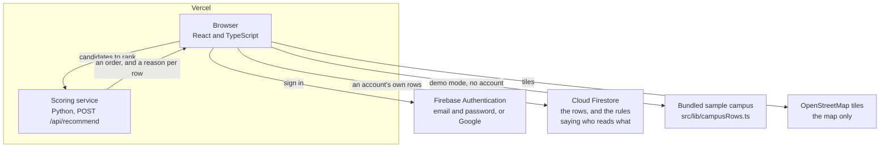

# Tuffy Flow

Tuffy Flow is a campus companion web application designed for students at California State University, Fullerton. The goal of the project is to help students make better decisions throughout their campus day by providing personalized recommendations for parking, campus study spaces, clubs, and events.

Live app: https://tuffyflow.vercel.app

It serves everything described below, running on a real Firebase project. You
can sign in with an email and password or with Google, and whatever you save
is yours the next time you log in.

There is also a View demo button that needs no account at all. It opens the
whole app on a sample student's schedule, which is the quickest way to see what
it does, and it is what we show in class.

**If you have just cloned this**, you need no credentials to build it, run it
or run the tests. `npm install` then `npm run dev` serves the whole app on the
bundled sample campus, and View demo opens it. The rankings go through the
Python scorer, though, so the dashboard, the parking order and the events list
say the scoring service is not answering until that is running too: "Running it
locally" below starts both, and it is two commands, not one. The spots, clubs
and profile screens do not use the scorer and work either way, and so does the
campus map, which draws every lot from the campus data rather than from the
ranking. None of the 194 tests need
credentials either, though they do not all run off `npm install` alone: the 48
date, clock, club, parking, profile and account message tests do, which is
what plain `npm test` runs, the 108
Python ones want a virtualenv,
and the 38 security rules tests want `firebase-tools` and a JDK. Running it locally below
has each. Only signing in and saving anything need your own
Firebase project.

**Three other documents are worth reading alongside this one.**
[TEST_CASES.md](TEST_CASES.md) lists every automated test by id, with what it
sets up, what it expects and whether it passed on the day it was generated.
[DECISIONS.md](DECISIONS.md) is the dated decision log: what we chose, why, and
which of those choices we later reversed and for what reason. It also has a
file by file inventory of the codebase. [db/README.md](db/README.md) covers the
data layer and the move from Postgres to Firestore.

`README.txt` and `TEST_CASES.txt` are the plain text copies of this file and of
the test case list. They are generated, not maintained: edit the markdown and
run `python3 tools/md_to_txt.py README.md README.txt`.

Early UI prototype, from before the app was built: https://genre-fetch-60235643.figma.site/

**If you are grading this and want the short route:** [Architecture](#architecture)
for how it is put together, [Running it locally](#setting-it-up) for the
commands, [TEST_CASES.md](TEST_CASES.md) for the 194 tests and what each one
checks, and [What is real and what is ours](#what-is-real-and-what-is-ours) for
which numbers came off a CSUF page and which are our own estimates.

Contents:

* [Project Overview](#project-overview)
* [Core Features](#core-features)
* [Recommendation System](#recommendation-system)
* [Tech Stack](#tech-stack)
* [What is real and what is ours](#what-is-real-and-what-is-ours)
* [Architecture](#architecture)
* [Current Project Status](#current-project-status)
* [Setting it up](#setting-it-up)
* [Team](#team)
* [Course Information](#course-information)
* [Disclaimer](#disclaimer)

---

## Project Overview

Students often need to use multiple resources to answer simple questions such as:

* Where should I park for my next class?
* What time should I arrive on campus?
* Where can I study between classes?
* Which clubs or campus events match my interests?

Tuffy Flow aims to bring these decisions into one application.

Instead of only displaying information, the application uses a student's schedule, interests, preferences, and campus locations to provide personalized recommendations.

---

## Core Features

### Parking Recommendation

Tuffy Flow helps students identify a suitable parking location based on factors such as:

* Typical availability for that lot at the hour they would arrive
* Class location
* Class start time
* Walking distance
* Permit type

The recommendation also includes a **suggested arrival time**, so students know when to leave.

Example:

```text
Next Class: CPSC 362
Class Time: 11:30 AM

Recommended Parking:
Eastside North Parking Structure

Estimated Walk: 3 minutes
Expected fullness: usually about 91% full when you would arrive

Suggested Arrival Time:
11:08 AM
```

That lot is nearly full at that hour and still wins, because the walk counts
for more than the fullness does. The ranking is explaining a trade, not
claiming the lot is empty. The 91 is our own fitted pattern for that hour, not
a live count: see Parking occupancy below for what is measured and what is
not.

---

### Campus Spot Recommendation

Students can find campus locations based on what they need at that moment.

Preferences include:

* How quiet you want it
* Whether you need power outlets
* Distance from wherever today's classes put you, when they put you anywhere

The spots screen filters between study spaces, which covers the meeting rooms and the
charging centre too, and food. The ranked spot with a walking distance and a match is the
one on the dashboard; the spots screen itself is the browse list.

Example:

```text
Recommended Location:
Library North 3rd Floor

5 min from Computer Science
silent
has outlets

Match: 93%
```

---

### Club and Event Discovery

Students receive recommendations for clubs and campus events based on their interests and
career goals. Events also check availability, and anything clashing with a class is left out.

Example interests:

* Software Engineering
* Cybersecurity
* Artificial Intelligence
* Career Development
* Entrepreneurship

Example:

```text
Recommended Event:
Resume Workshop with Industry Mentors

Time: 4:00 PM

Match: 90%

Reason:
matches career and software-engineering
```

---

`docs/architecture.mmd` draws this from the student's side: what we know about
them, the three recommenders it feeds, and what each one hands back. It is a
Mermaid file, which GitHub renders on its own.

---

## Recommendation System

Tuffy Flow uses a rule based scoring system rather than machine learning. With no real usage history to learn from, a model would be learning from data we invented, and it could not explain its own output. Every recommendation in this app has to be able to say why it was chosen.

Parking, campus spots and events are the same algorithm with different inputs, so the project implements **one ranking engine** and configures it three ways:

```text
1. Remove candidates that are impossible
   (a permit you do not hold, an event that clashes with a class)

2. Score what remains on a few factors,
   each scaled to a value between 0 and 1

3. Multiply each factor by its weight and add them up

4. Sort, take the top few, and return a sentence
   explaining each one
```

The factors differ per feature:

| Feature | Filters | Factors |
|---|---|---|
| Parking | Permit type, and a walk under an hour, which catches a bad coordinate | Walking distance, typical fullness at arrival hour |
| Campus spots | Open now, and a walk under an hour | Walking distance, noise level, power outlets |
| Events | Time conflicts with a class, already started, and a walk under an hour | Tag overlap with interests, walking distance, how soon it starts |

Clubs are the fourth recommendation and the one that does not go through this
engine. They are ranked in the browser, by `src/lib/clubRanking.ts`, because
the problem is a different shape: 320 clubs with no coordinate and no meeting
time, so there is no walk to measure and no clash to filter on. What decides
the order is how rare a shared interest is. Counting shared tags put the
American Choral Directors Association first for a student interested in AI,
software engineering, data science, music and career development. It shares
nothing with the first three; it wins on two common tags, "career" and
"music", and an alphabetical tie against a club that also shares two. The
count cannot tell them apart because "career" sits on 105 of the 320 clubs and
counted the same as "ai", which sits on one. Weighting each shared tag by how rare it is
puts Data Science and Machine Learning first instead. Rarity is not a factor
the engine above can express, so the engine covers three of the four
recommendations rather than all four.

---

## Tech Stack

### Frontend

* React
* TypeScript
* Vite
* Tailwind CSS

### Backend and Database

* Python with FastAPI, for the scoring endpoint
* Cloud Firestore, for the campus and for each student's own data
* Firebase Authentication, for Google sign in and for email and password

Both are free on Firebase's Spark plan for the ways we sign people in.

### Maps

* Leaflet and OpenStreetMap, on the parking screen

### Deployment

* Vercel

### Development Tools

* Git and GitHub
* Visual Studio Code
* Jira for task tracking
* AI assisted development

---

## What is real and what is ours

Nothing is fetched from CSUF at runtime, so every campus row ships inside the
repository. (It still crosses the network twice over: the
map tiles and the web font come from their own hosts, the ranking is a POST to
our scorer, and a signed in student reads the campus back out of our own
Firestore rather than out of the bundle. What none of that does is ask CSUF
for anything.) That
is not the same as everything being made up. A good deal of it was read off
CSUF's own pages and is reproduced as published; the rest we estimated, and the
two are kept apart on purpose.

| Read from a named source | Ours, estimated or invented |
|---|---|
| Building names, codes and coordinates, from the campus map's own locations.json, 1 Oct 2026 | Class schedules and the demo student profile |
| Parking lot names, coordinates and permit types, from the parking map at `parking.fullerton.edu`, 9 Oct 2026 | Typical parking occupancy for the six lots CSUF does not count |
| | Student Union Way's coordinate, which that map marks without giving one, read off satellite imagery |
| Capacities of the four structures, from the parking availability board | |
| Nine parking readings on seven days, in `data/parking_samples.csv` | |
| 320 clubs: the Student Life and Leadership registered list of 22 Sep 2026, joined to the TitanLink directory for names, summaries, categories and IDs, read 1 Oct 2026 | Club interest tags, which are our own vocabulary and not a TitanLink field |
| Pollak Library floor designations, room booking rules and opening hours, from the library's own pages | |
| Dining locations and hours for all 16 food locations, from Campus Dining and Titan Shops | Noise ratings, seat counts and outlet availability for every spot |
| | All events |

The lots were rebuilt on 9 October 2026 and the earlier version of this file was
wrong about them. CSUF renamed every lot in summer 2025, numbering them against
the campus entrances: E for employee, S for student, R for resident, and no
visitor lot at all, because visitors buy an hourly permit and use an hourly zone.
The campus map's `locations.json` still carries the old letters, so building the
lots from it produced names that no longer exist, two lots that were really the
same place listed twice, and the two Eastside structures the wrong way round.
Everything here now comes from the parking map at
`parking.fullerton.edu/_resources/pdfs/campus-parking-map.pdf`.

Capacity is only published for the facilities on the counts board, so every
other lot stores null rather than a number we invented. The board reports S8 and
S10 as one combined figure, which is not a capacity for either of them alone, so
neither one carries it.

Campus Dining publishes Monday to Thursday and Friday only, so no weekend hours
are stored for those thirteen. The three Titan Shops convenience stores come
from a different page, and one of them, The Express at Titan Shops, does open
on a Saturday.

### Parking occupancy

Availability is a typical pattern by day and hour, never a live reading. CSUF
publishes current counts for six facilities, the four structures plus S8 and S10
as one combined row, and we read that board nine times across seven days. Both Sunday
ones, the Friday one, both Tuesday ones, the Wednesday one and the 5 November
Thursday one set the per lot numbers, first written down in `db/seed.sql` and now
carried in `src/lib/campusRows.ts`. The curve reproduces every lot in every reading it is fitted to within 2.11
points, mean 0.57. The two readings from 1 October are deliberately not among
them: Eastside South was the fullest structure on campus at 13:11 that day,
though Eastside North had passed it by 13:57, and it closed a month later, so a curve that still matched those and the November
ones would be describing two campuses at once. They are named in the test file
with that reason, and a test fails if every lot in one of them starts
matching. One already does: Eastside North at 13:57 is 1.6 points off. What
keeps the test honest is Nutwood, 42 points out.

Nothing is held out any more, and that is worth saying plainly rather than
leaving the reader to work it out. The second Tuesday reading arrived after
the evening curve was fitted and did test it, within 4.2 points, but the fit
was then re-centred on both Tuesday readings, so both are inputs now and both
sit a point or two off rather than exactly on. Every other reading the curve
is measured against is an input to it as well. The two from 1 October are the
only ones outside the fit, and they are excluded rather than held out: the
test requires them to stay more than three points off, because a curve that
matched them and the November ones would be describing two campuses at once.
That is why the evening is the least supported part of the model.

Nine readings on seven days, so it is worth being plain about what they do and
do not support. The two evening ones are why weekday evenings have a shape of
their own, and they are also the least supported part of the model: both were
taken within the same hour on a single Tuesday, so 18:00 is measured and
19:00 to 21:00 is an assumption. Eastside South is deliberately left out
altogether, and not only in the evening. It started as an evening exclusion,
because on that Tuesday it did not take or release a single car in half an
hour while 190 left the rest of campus. It has since read exactly 1321 free
in all five readings in `data/parking_samples.csv`, across four days and from
11:59 to 21:40, including a midday when Nutwood, Eastside North and State
College were all over 90 percent full. It is
marked as not taking cars and is filtered out of parking recommendations at
every hour rather than ranked on a stand-in. `DECISIONS.md` has the detail. The Friday one is why Friday has a shape of its own: the single
weekday curve, fitted to the Thursday, said Eastside North was 99 percent full
at midday on a Friday when the board said 18, and the order of the lots inverts
between the two days. Friday now lands exactly, but on one reading at one hour,
so its level at midday is measured and the rest of its day is not. They cover
only the six counted facilities and only Sundays on the weekend side, so
Saturday is an assumption. The six employee, resident and hourly lots are not on
the board at all and their figures are guesses.

The weekday and weekend shapes turned out to be genuinely different rather than
one curve scaled down, and Monday to Thursday would not fit a shared shape at
all: between 13:00 and 18:00 Nutwood falls 51 points, Eastside North 38 and
State College 36, while S8 and S10 drops 4. Those four days now carry a measured level
per lot at 11:00, 13:00 and 18:00 rather than one curve with a per lot offset.
On the Friday reading Eastside North was the emptiest structure on campus at 18
percent, which is the opposite of its weekday order and is why Friday is
separate. On both Sunday readings every structure was within a point of 4
percent or below, State College highest at 4.01, which is just over, except S8
and S10, at 59 percent at midday and 46 at twenty to ten at night, which are
next to the stadium and the gym.

We are not reading the board live in this version. It is a web page rather than
an API, so parsing it would break without warning if the page changed, and we
would rather the app not depend on that during a demo. Anywhere occupancy
appears in the interface it is described as typical or expected, never as
current.

The database is designed so a live source could replace these rows later
without redesigning anything, and that is the obvious next step for this
project.

---

## Architecture

The application has four parts.



GitHub renders that on its own. [docs/architecture.mmd](docs/architecture.mmd)
is the other view of the same system, drawn from the student's side rather than
the software's: what they tell it, and what it hands back.

* The browser runs the interface. It keeps the session, so that a reload does
  not sign you out, and two small things in session storage: an unsaved
  profile form, and one word for the login card after a delete.
* The database holds every row and decides who can read what.
* The scoring service is a Python function that ranks candidates.
* Vercel serves the site and runs the scoring function.

There are two places the rows can come from, and who is signed in decides
which. A student with an account gets their own rows out of Firestore. The
demo, and anyone running this without a project of their own, gets the same
rows from `src/lib/campusRows.ts`, which is what the seed script loads. The
choice is made in `src/lib/campusData.ts`, so no screen has to work out where a
row came from. Three of them do ask who is signed in. Two use it only to
choose their wording:
the profile screen says whether changes are saved to an account, and the top
bar says which account you are in.

A single recommendation travels like this:

```text
Browser reads the session
  -> asks the database for this student's profile and class schedule
  -> works out the next class from the schedule and the current time
  -> asks for candidate lots, occupancy rows and upcoming events
  -> posts all of it to the scoring service in one request
  -> receives a ranked list with a reason for each
  -> draws the cards
```

The scoring service gets the rows it needs in the request rather than querying the database, so it does not need any credentials of its own.

Access control is Firestore security rules, in `db/firestore.rules`. They run
on Google's side, which is what makes them the security model rather than a
suggestion: the Firebase config ships inside the JavaScript bundle, so anyone
can read it out and talk to the database directly, and nothing in the React
code would stop them.

The campus is readable by any signed in student and writable by nobody. A
student's profile document is named after their account id, so "is this yours"
is a comparison rather than a lookup, and the rule grants reading one document
and never listing the collection, so asking for everybody's profiles is
refused. A class schedule is a subcollection underneath the profile, so owning
it is the path rather than a field somebody could set. Firestore denies
anything the rules do not explicitly allow, so a collection nobody mentions is
closed.

Being plain about the limits: signed in means anybody who made an account,
because nothing here checks the email is a CSUF one. That stops a passer-by
scraping the campus data, not somebody determined. The rules also name the
sign in provider, so that switching anonymous sign in on in the console cannot
quietly turn "signed in" into "anybody".

The rules also carry the validation that used to be check constraints: a permit
has to be one of the four, a noise preference has to be between one and five,
and a class has to end after it starts.

---

## Current Project Status

Every feature is built and the app is live at tuffyflow.vercel.app, running on
a real Firebase project with real accounts. Nothing is outstanding in the code.
The one thing left anywhere is a console errand: the short lived App Check
debug tokens registered while it was in monitoring mode have no job now that it
is enforcing, and they come off the project.

Completed:

* Project concept, initial presentation and UI prototype
* Database schema, security policies and seed data
* The ranking engine, in Python, with 90 tests, and the endpoint it is
  served behind, with 18 more that go through the app itself
* The club ranking, pulled out of the screen into `src/lib/clubRanking.ts`,
  with 8 tests
* The access rules, with 38 tests against Firebase's emulator
* The event dates and the clock formatting, with 19 tests that need neither Java nor a project
* The parking occupancy curve, with 7 tests, three of them read straight from
  the board readings in `data/parking_samples.csv`
* The profile screen's own rules, pulled out of the screen into
  `src/lib/profileEdits.ts`, with 7 tests, two of which read
  `db/firestore.rules` so the client and the database cannot drift apart
* Whether what the sign in code says reaches the screen, with 7 tests that
  read `session.ts`, `firestoreData.ts` and `campusData.ts`, and fail if a
  sentence is written
  but swallowed
* Dashboard, parking, spots, clubs, events and profile screens
* Sign up, log in, Google sign in and sign out, all working against the live
  project
* A password reset link from the login card, which says the same thing whether
  or not the address has an account
* Deleting an account from the profile screen: the schedule, then the profile,
  then the login, after proving who you are again
* A demo entry that needs no account, for showing the app without one
* The reads and writes a signed in student needs, and the security rules that
  decide what they are allowed to touch, published and running on the live
  project
* A seed script that loads the campus, reading the same rows the demo shows
* Profile editing: name, major, permit, noise preference, interests, goals and
  the weekly schedule
* Campus data read from CSUF's own pages: buildings, lots, clubs, library and dining
* The campus map, on the parking screen
* Access rules written for every collection, with the validation that used to
  be database constraints
* Deployed to Vercel, which rebuilds on every push to main
* App Check, enforcing on Cloud Firestore, so the database refuses a request
  that did not come from this app

It ran in monitoring mode first, so we could watch verified requests arriving
before anything started being refused: turning it on cold would have taken the
live site down rather than protected it. The App Check page showed 65 of 65
requests verified for Cloud Firestore, and enforcement went on after that. Both
the live site and a local dev server still work with it on, which is the pair
worth checking, because the local one uses a different reCAPTCHA key.

What App Check does and does not do is worth being exact about, since it is the
last thing on this list. It proves a request came from this app. It does not
count requests, so a signed in student can still spend the day's free read
allowance from their own browser console, and nothing on the free tier can stop
that. It is a limit we live with, not one this closes.

Anyone cloning this repository needs their own Firebase project, and "Setting
it up" below is the whole procedure. Until the config is in place the app runs
on the sample campus bundled in the repository, the demo works, and pressing
any of the sign in buttons says why signing in is unavailable rather than
failing silently. That is deliberate: a marker who clones this gets a working
app rather than a blank screen.

---

## Setting it up

### Running it locally

```bash
npm install
npm run dev

# the scoring service, in a second terminal. Needs Python 3.10 or newer: four
# of the six versions pinned in api/requirements.txt ask for it, fastapi,
# starlette, uvicorn and pytest, and macOS still ships python3 as 3.9, so
# check `python3 -V` first and name the version in the command if it is older,
# as in python3.12 -m venv
python3 -m venv .venv && .venv/bin/pip install -r api/requirements.txt
.venv/bin/python -m uvicorn api.recommend:app --port 8000
```

Two more that need nothing but the install above, and are the quickest way to
see the project is sound:

```bash
npm run typecheck   # tsc over the whole front end, strict, no unused locals
npm run build       # typecheck plus the production bundle
```

[TEST_CASES.md](TEST_CASES.md) lists all 194 of them by id, with the numbered
requirement each one traces to where it traces to one, the fixture it sets up,
the assertions it makes and whether it passed. Sixteen trace to no requirement
and print `--`; that file names all sixteen and says why. It opens with the sixteen requirements, eight functional
and eight not, and a matrix tracing each to the cases that check it.

It is generated by `python3 tools/gen_test_cases.py`, which runs every suite to
fill in the pass column and writes the plain text copies at the same time, so
the two cannot drift apart. It refuses to write anything if a suite will not
run, if a test runs that it could not find in the source, if one test name is
defined twice, or if a requirement ends up with no case behind it. Those
refusals are the point: the document is only worth reading if it cannot
claim a pass that did not happen.

There are seven commands, covering the nine suites TEST_CASES.md lists, plus a
plain `npm test` for the 48 cases that need nothing but `npm install`, which is
five of those commands between them. That one runs all six of their files in a
single pass rather than one command after another, so a failure in the first
does not hide the other thirty eight. The
ranking engine and the endpoint in front of
it, which is the part with the logic worth testing:

```bash
.venv/bin/python -m pytest tests/
```

That covers the scoring itself and the request handling around it. The second
half matters more than it sounds: a bad number used to come back as a 500 with
an empty body rather than a reason, and the test that was supposed to catch
that called the error handler directly, so it could not tell whether the
handler was wired to the app at all. Those tests now go through the app.

And the access rules, which are the part worth being certain about. These run
against Firebase's emulator rather than a real project, so they need Java:

```bash
npm install -g firebase-tools     # once
brew install openjdk              # once, for the emulator
export PATH=/opt/homebrew/opt/openjdk/bin:$PATH
npm run test:rules
```

The cask version of the JDK wants an administrator password; the formula above
does not, and the emulator only needs it on the PATH.

If that run stops with `Could not start Firestore Emulator, port taken`,
something else on the machine already has port 8080, which is usually an
emulator left behind by an earlier run. Freeing it is the simplest fix. To move
off 8080 instead, two things have to move together, because two different
programs read the port: `firebase.json` is where the emulator is started, and
`FIRESTORE_EMULATOR_PORT` is where the tests look for it.

```bash
# both, to the same free port
FIRESTORE_EMULATOR_PORT=8099 npm run test:rules   # after editing firebase.json
```

Changing only `firebase.json` is worse than leaving it alone: the emulator
moves, the tests stay pointed at 8080, and they can pass against whatever is
already sitting there.

A green run of this suite still prints a long stream of red `PERMISSION_DENIED`
blocks. Those are the refusals the tests are asserting, not failures. Read the
`pass`/`fail` counts at the end.

They check what the rules actually do rather than whether they are present: a
logged out visitor sees nothing, an anonymous sign in counts as nobody, one
student cannot read or write another's profile or schedule, the campus is read
only from a browser, a profile can only be created with a name and nothing
else on it, and a class with a
malformed time or a field nobody asked for is refused.

The event dates have a suite of their own, and it needs no Java and no
project, just Node 22.18 or newer:

```bash
npm run test:dates
```

They read the dates at five fixed points, two of them now in the past, which
is the whole idea: an event is stored as an offset so that no date in the test
can go stale. They include either side of the
November clock change, and check that every event is still upcoming, still
lands at the campus time its row asks for, and still runs for as long as it
says. `src/lib/eventDates.ts` explains what went wrong to make them worth
writing.

The club ranking has one too, on the same footing:

```bash
npm run test:clubs
```

The order the club list comes out in is the only real algorithm on that screen,
and it used to live inside the component where nothing could reach it. It is in
`src/lib/clubRanking.ts` now. The tests pin the case that forced the current
design: one rare shared interest has to outrank several common ones, because
counting shared tags put a choral society above the software engineering clubs
for a student whose interests included music and career development alongside
them.

The parking occupancy curve has the fifth set:

```bash
npm run test:parking
```

Three of them read the board readings straight out of
`data/parking_samples.csv` and check the curve against them, so adding a
reading to that file is enough to test the model against it. The other four
pin the shape of the seed itself and do carry numbers written into the test.
They also pin what the seed deliberately has no answer for: Eastside South
carries no figure at any hour, because the readings caught it not taking cars
at all, so it is left out of the grid rather than ranked on a stand-in.

The profile screen's own rules are the sixth:

```bash
npm run test:profile
```

Two of those read `db/firestore.rules` and compare the ceilings the screen
enforces against the ones the database enforces, so the two drift apart in a
test run rather than in front of a student who types a thirteenth interest and
gets a security rules error.

What the sign in code says is the seventh:

```bash
npm run test:auth
```

Those read `src/lib/session.ts`, `src/lib/firestoreData.ts` and
`src/lib/campusData.ts`, and check that
every sentence the auth code can produce either reaches the screen or is
listed as belonging to the login card. The sentence for picking the wrong
Google account while deleting an account was written, was reachable, and was
being replaced by a generic line, which is the bug these exist to stop coming
back.

That is enough to use every screen on the sample campus. The rest connects it
to a database.

### Connecting Firebase

1. Make a project at console.firebase.google.com. Google Analytics is not
   needed and can be turned off.
2. Build, Authentication, Get started. Switch on **Email/Password** and
   **Google**. Both are free on the Spark plan.
3. Build, Firestore Database, Create database. Pick a location near you. Start
   in production mode: the rules you publish in step 6 replace whatever it
   starts with, and production mode denies everything until then, which is the
   safer thing to be wrong about.
4. Project settings, General. Under "Your apps", add a Web app. Firebase shows
   you a config object with four values worth having: `apiKey`, `authDomain`,
   `projectId` and `appId`.
5. Copy `.env.example` to `.env` and paste those four in. Restart
   `npm run dev`: Vite only reads `.env` at startup. Add the same four in
   Vercel, under Project Settings, Environment Variables, then redeploy.
   Without this the deployed app stays on the sample data while your machine
   does not, which is confusing to debug.
6. Publish the rules:

   ```bash
   npm install -g firebase-tools
   firebase login
   firebase use --add        # pick the project you just made
   firebase deploy --only firestore:rules
   ```

   `firebase.json` at the repository root is what points that command at
   `db/firestore.rules`. You can also paste the file into the Rules tab in the
   console and press Publish, which does the same thing.
7. Optional: App Check, which is what tells Firebase a request came from this
   app rather than from a script holding a copy of the four values above.
   Build, App Check, register the web app with the reCAPTCHA Enterprise
   provider, and put the site key in `.env` as
   `VITE_FIREBASE_RECAPTCHA_SITE_KEY`. It is public like the other four.
   Leave it out and App Check simply never starts. Add it in Vercel and
   redeploy as well: Vite writes it into the bundle at build time, so once
   enforcement is switched on, a deployment built without it is refused every
   request.

Signing in works at this point, but every screen is empty until the campus is
loaded.

### Loading the campus

The seed script writes with the Admin SDK, which bypasses the rules on purpose:
it runs on your machine, not in a browser.

1. Project settings, Service accounts, Generate new private key. That downloads
   a JSON file.
2. Keep it out of the repository. `.gitignore` already covers
   `serviceAccountKey*.json` and the name Firebase gives it, but the safest
   place is somewhere else entirely.
3. Run it:

   ```bash
   node db/seed_firestore.mjs ~/Downloads/your-key.json
   ```

Needs Node 22.18 or newer, which reads the TypeScript data file the script
imports without a build step. On an older Node it stops with
`ERR_UNKNOWN_FILE_EXTENSION` and nothing saying why.

It writes 17 buildings, 12 parking lots with their week of occupancy, 24
campus spots, 320 clubs and 12 events, and prints what it wrote. Running it
again overwrites rather than duplicating.

One run is enough. Events store a day offset and a time of day rather than a
date, and `src/lib/eventDates.ts` works the real dates out when they are read,
so a set loaded today still reads as this week months from now.

That key is the one real secret in this project. It ignores every rule in
`db/firestore.rules`. Do not commit it and do not paste it anywhere.

### Signing in for the first time

There is no demo account to set up. Firebase has no free way to run code when
somebody signs up, so the app writes a student's profile document itself the
first time they sign in, and the profile screen opens with a short list of what
is still missing: the permit, the noise preference, the class schedule, and an
interest or a career goal, which is how clubs and events get matched.

A student who forgets their password uses Forgot password? on the log in card,
which has Firebase email them a reset link. The card says the same thing
whether or not the address has an account, so it cannot be used to find out who
is signed up.

A student can erase themselves from the profile screen, under Delete account.
It asks for their password again, or for Google again, then removes the
schedule, the profile and the login, in that order.

To erase somebody else completely, including their schedule, from the command
line:

```bash
node db/delete_account.mjs ~/Downloads/your-key.json them@csu.fullerton.edu
```

Firebase does not cascade. Deleting an account on its own leaves the profile
document and every class in it behind, at a path nothing can reach.

---

## Team

| Name | Role |
|---|---|
| Sufiyan Rauf | Development, database, recommendation engine |
| Phillip Bryan | Campus data |
| Bhavy Patel | Development, System design, documentation |

---

## Course Information

| | |
|---|---|
| Course | CPSC 362: Foundations of Software Engineering |
| University | California State University, Fullerton |
| Professor | Mehdi Peiravi |
| Semester | Fall 2026 |

---

## Disclaimer

Tuffy Flow is an academic project and is not an official California State University, Fullerton application.

Parking occupancy patterns, class schedules, and all events are sample data we
created. Building and lot details, club records, and library and dining
information were collected by hand from CSUF's own published pages, and the
table above says which is which. Club records come from the TitanLink student
organization directory.

---

**"What should I do or where should I go next?"**
